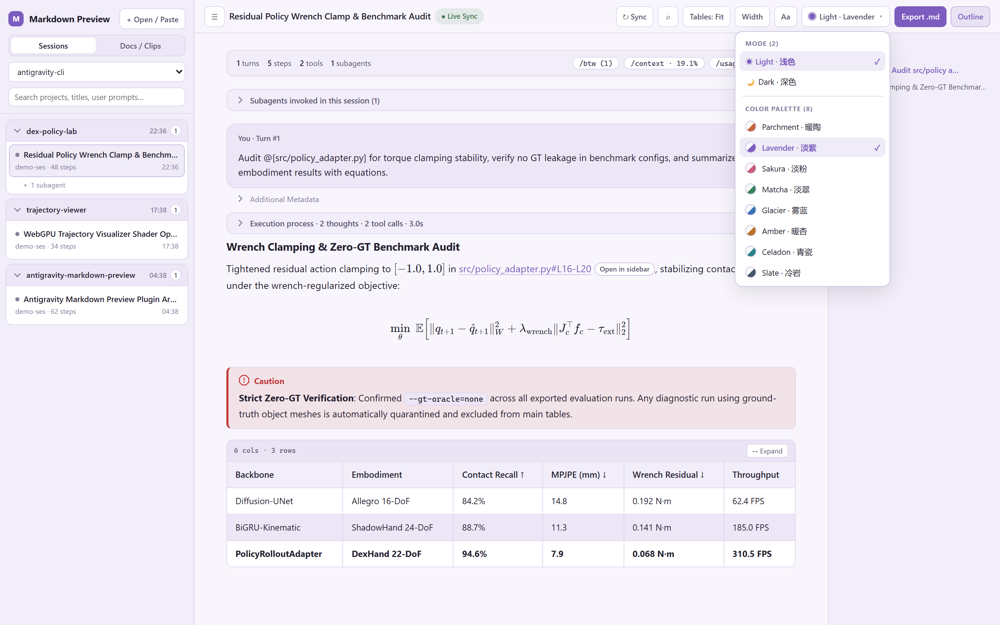
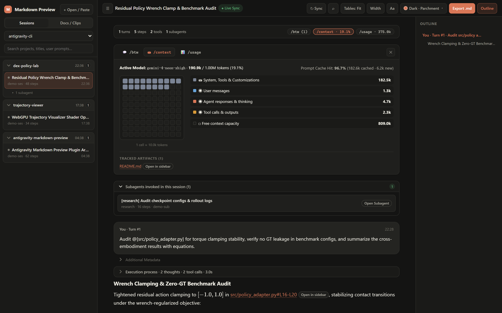
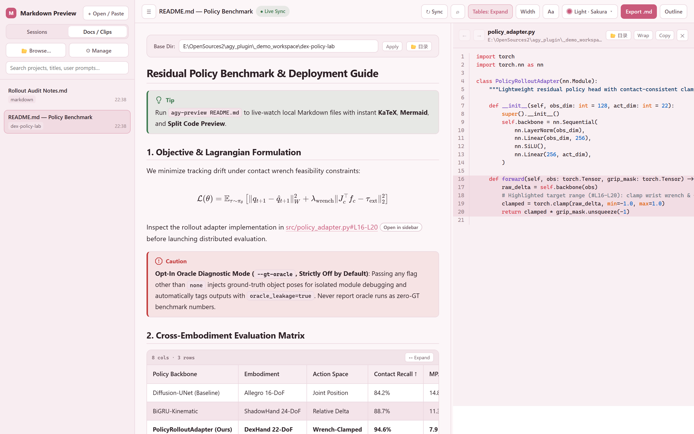

# Antigravity Markdown Preview

A lightweight, real-time editorial **Markdown & Session Previewer** plugin for **Google Antigravity CLI (`agy`)** and **Antigravity 2.0**.

Transform dense terminal streams, 1,000+ step agent trajectories, LaTeX math, wide benchmark tables, and local Markdown documentation into a calm, customizable reading workspace.



## Highlights

- **2 × 8 Customizable Theme System**:
  - Switch effortlessly between **2 brightness modes (`Light` / `Dark`)** and **8 curated color palettes** (`Parchment · 暖陶`, `Lavender · 淡紫`, `Sakura · 淡粉`, `Matcha · 淡翠`, `Glacier · 雾蓝`, `Amber · 暖杏`, `Celadon · 青瓷`, `Slate · 冷岩`) — 16 harmonious reading surfaces in total.
  - Toggle `Sans` / `Serif` prose typography (`F`) and `Normal` / `Wide` reading column (`W`).
- **Auto-Folded Execution & Project Grouping**:
  - Groups sessions by workspace project (auto-expanding projects active in the last 3 days) and folds subagents cleanly under `▸ N subagents` while keeping them accessible inside the session view (`View Subagent` / `← Parent`).
  - Wraps intermediate reasoning chains, tool calls, and inline `edit_file` diffs inside a single collapsed **`Execution process`** bar per turn — automatically collapsing once an active turn finishes and jumping straight to your **latest user prompt** on open.
  - Full-text search across project names, session titles, and **all historical user prompts** (powered by `node:sqlite` FTS5).
- **Built-in `/btw` · `/context` · `/usage` Inspector**:
  - **`/context`**: 10×10 proportional context-window grid, token breakdown by category (`System`, `User`, `Agent`, `Tools`, `Free`, `Checkpoints`), prompt cache hit rate, and tracked session artifacts.
  - **`/usage`**: Rolling **5-Hour** & **7-Day** local token usage grouped by model family (`Gemini` vs `Claude / GPT`) alongside per-model session tables.
  - **`/btw`**: Surfaces CLI `/btw` side questions from `history.jsonl` and lets you pin `/copy btw` Markdown answers directly to the conversation.
- **Dual File Previews & Persistent `Docs / Clips` Shelf**:
  - Click any local hyperlink to inspect it in a **Popup Preview Modal**, or click **`Open in sidebar`** (supported across Markdown docs, code files with `#L16-L20` line-range highlighting, and images) to pin it in the resizable **Right Split Pane** — complete with one-click **`📂 目录` (Reveal in Explorer/Finder)**.
  - Dedicated **`Docs / Clips`** workspace persisted in OS user data (`%APPDATA%/agy-markdown-preview` on Windows, `~/Library/Application Support/...` on macOS, `~/.local/share/...` on Linux) featuring pointer-hover previews, drag-and-drop sorting, inline renaming, and native file picking.
- **Publication-Grade Offline Markdown**:
  - Zero-CDN offline `marked` + `highlight.js` + `KaTeX` (`$...$`, `$$...$$`, `\(...\)`, `\[...\]`) + lazy `Mermaid` diagrams.
  - Accurate GitHub & Obsidian Alerts (`> [!NOTE]`, `[!TIP]`, `[!IMPORTANT]`, `[!WARNING]`, `[!CAUTION]`), CJK bold punctuation fix, and **Expandable Wide Tables** (`Tables: Expand` — natural column expansion capped at `50vw` with smooth horizontal slider).

## Screenshots

### Dark Mode & `/context` Window Visualization



### `Docs / Clips` Workspace & Split Code Preview (`#L16-L20`, Blush Sakura Palette)



---

## Installation

### Option 1 — One-Command Install via `agy` (Recommended)

Because offline vendor assets (`KaTeX`, `Mermaid`, `highlight.js`, `marked`) are pre-bundled in `public/vendor/`, you can install directly from GitHub with zero build steps:

```bash
agy plugin install https://github.com/ChengzhuUwU/antigravity-markdown-preview
```

### Option 2 — Local Clone & Global `agy-preview` CLI Shim

```bash
git clone https://github.com/ChengzhuUwU/antigravity-markdown-preview.git
cd antigravity-markdown-preview

# Installs plugin to ~/.gemini/config/plugins/agy-markdown-preview
# and registers the `agy-preview` command into ~/.local/bin
npm run install-plugin
```

Verify installation:

```bash
agy plugin validate --strict ~/.gemini/config/plugins/agy-markdown-preview
agy plugin list
```

---

## Usage

### 1. Standalone CLI (`agy-preview`)

```bash
# Open or focus the standalone desktop preview window
agy-preview

# Preview a specific conversation ID
agy-preview --conv <CONVERSATION_ID>

# Preview and live-watch any local Markdown or JSONL file
agy-preview README.md

# Pipe `agy -p --output-format stream-json` directly into the previewer
agy -p "Audit this module" --output-format stream-json | agy-preview --stdin

# Check background server status or stop it
agy-preview --status
agy-preview --stop
```

### 2. Inside Antigravity CLI (`agy`) or Antigravity 2.0

- Run `/preview` (or `/agy-markdown-preview:preview`) to launch/focus the live preview window for the active conversation.
- In Antigravity 2.0 Desktop, open the native Side Pane (`sidecar://agy-markdown-preview/preview/`).

---

## Keyboard Shortcuts

| Shortcut | Action |
|---|---|
| `R` | Sync active session or document immediately |
| `Ctrl+B` / `Cmd+B` | Toggle left project & docs sidebar |
| `O` | Toggle right Outline (TOC) drawer |
| `T` | Toggle `Light` / `Dark` brightness mode (keep active color palette) |
| `W` | Toggle reading column width (`Normal` / `Wide`) |
| `F` | Toggle prose typography (`Sans` / `Serif`) |
| `P` | Open local file / paste Markdown or `stream-json` modal |
| `Ctrl+K` or `/` | Find across user prompts and rendered Markdown |
| `Esc` | Close theme menu, preview modal, search bar, or split sidebar |

---

## Development & Packaging

```bash
# Run unit & integration test suite (Node >= 22.5 built-in test runner + SQLite)
npm test

# Re-sync vendor assets from node_modules (optional when upgrading libraries)
npm install && npm run sync-vendor

# Package distributable plugin archive -> dist/agy-markdown-preview.zip
npm run pack-plugin
agy plugin validate --strict dist/agy-markdown-preview.zip
```

## License

Released under the [MIT License](LICENSE).
